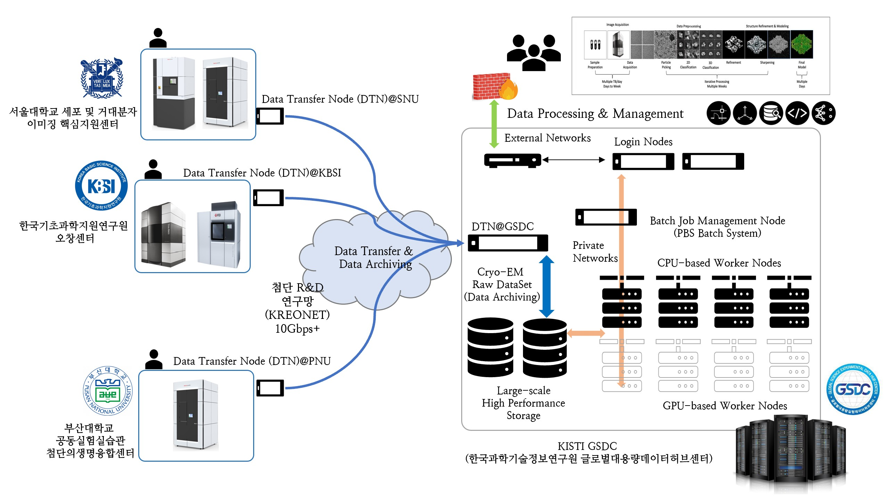

# Computing and Storage Resources in GSDC TEM

/// caption
Overall architecture of GSDC TEM Computing and Storage Resources (including Data Transfer Nodes)
///

## Login Servers

| Server Name            | Specification                                                           | Remarks               |
| ---------------------- | ----------------------------------------------------------------------- | --------------------- |
| __tem-ui-al9.sdfarm.kr__ | Intel Xeon 3.1GHz 18Core * 2CPUs, 384GB Memory                          | 72 Cores (w/ HT)      |
| __tem-cs-al9.sdfarm.kr__ | Intel Xeon 2.7GHz 18Core * 2CPUs, 384GB Memory                          | 72 Cores (w/ HT)      |

## Data Transfer(Mover) Servers

| Server Name            | Specification                                                           | Remarks               |
| ---------------------- | ----------------------------------------------------------------------- | --------------------- |
| __tem-dm-al9.sdfarm.kr__   | Intel Xeon 3.1GHz 18Core * 2CPUs, 384GB Memory                          | SFTP, GridFTP         |
| tem-dtn-el7                | Intel Xeon 2.7GHz 18Core * 2CPUs, 384GB Memory (only visible to CryoEM sites)                      | Rclone, GridFTP       |

## Batch System Server

| Server Name            | Specification                                                           | Remarks               |
| ---------------------- | ----------------------------------------------------------------------- | --------------------- |
| tem-ce-al9                 | Intel Xeon 2.7GHz 18Core * 2CPUs, 384GB Memory                          | PBSPro batch scheduler|

## Computing Resources

| Server Name                           | Specification                                                 | Remarks          |
| ------------------------------------- | ------------------------------------------------------------- | ---------------- |
| tem-cpu[00-11]-al9                    | Intel Xeon 2.6GHz 14Core * 2CPUs, up to 187GB memory per node (`mem=`) | 336 Cores total 12 nodes  |
| tem-gpu[01-02,05-12]-al9              | :material-check: up to 250~376GB memory per node (`mem=`)   :material-check: Nvidia P40, P100, V100, A100 GPUs          | 300 Cores total 26 GPUs total 10 nodes  |

Per-node cores, memory and GPU models are listed in [Batch Queues](../batch/queue.md).

## Storage Resources

| Category               | Specification                                   | Remarks                    |
| ---------------------- | ----------------------------------------------- | -------------------------- |
| Users Home Directory   | :material-check: 100GB / each account(ID)       | /tem/home/__UserID__       |
| Scratch Directory      | :material-check: 80TB / each research group     | /tem/scratch/__GroupDir__  |
| Archiving Directory    | :material-check: 500TB / each Cryo-EM site      | /tem/archive/__SiteDir__   |
