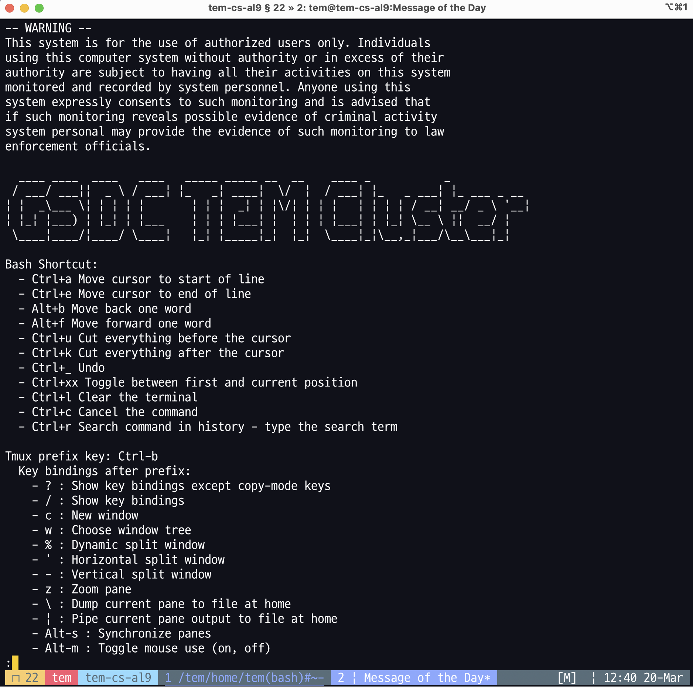

# Utilities for GSDC TEM Cluster

## **cluster.quota**

Run the `cluster.quota` command to check storage quota limits and usage on the Lustre filesystem (`/tem`).
This tool is available on all login nodes and on the data transfer node `tem-dtn-el7`.

It shows three sections — your home directory, your group's scratch directories, and site archive
directories — but **only the ones you have permission to read**. Directories belonging to other users
or groups are skipped; that is normal and is not an error.

```bash
$> which cluster.quota
/usr/local/bin/cluster.quota
```

### **Basic usage**

```bash
$> cluster.quota

  ┌───────────────────────────────────┐
  │ GSDC TEM 클러스터 — 스토리지 쿼터      │
  └───────────────────────────────────┘

  파일시스템 /tem   2.7P / 7.1P  ███████▍···········  39%
  실행        <UserID> @ tem-cs-al9   2026-10-13 13:23

  ┌───────────┐
  │ 사용자 홈   │
  └───────────┘

  경로                            PROJID      사용       한도 사용률                         파일 수
  /tem/home/<UserID>                3050     20.0G   제한없음      - ···················     269,547 ← 내 홈

  ┌───────────────────┐
  │ 연구그룹 스크래치     │
  └───────────────────┘

  경로                            PROJID      사용       한도 사용률                         파일 수
  /tem/scratch/<GroupDir>           2037    702.2G      80.0T   0.9% ▎··················     200,073

  ┌─────────────────┐
  │ 사이트 아카이브     │
  └─────────────────┘

  표시할 항목이 없습니다 — 3개 중 접근 가능한 것이 없습니다.
  (소속 그룹이 아닌 디렉토리는 접근이 차단됩니다. 정상입니다.)

  사용자 가이드 https://tem-docs.readthedocs.io/en/al9   ·   클러스터 자원·작업 현황은 cluster.monitor 를 참고하세요.
```

### **Options**

| Option | Description |
|---|---|
| `--all` | Also list directories you cannot read, with the reason (`권한 없음`, `경로 없음`). |
| `--brief` | One tab-separated line per directory. Convenient for scripts and `grep`. |
| `--json` | Machine-readable JSON. Includes unreadable entries with their error. |
| `--path PATH` | Query only the given path. May be repeated. |
| `--width N` | Force the table width instead of following the terminal. |
| `--no-color` | Disable colour. Colour is disabled automatically when the output is piped. |
| `-h`, `--help` | Show the option list. |

The exit status is `0` normally, `1` if any directory is over its hard limit or inside the grace
period, and `2` if the query itself failed. This lets you use it in a job script:

```bash
cluster.quota --brief > /dev/null || echo "Quota exceeded - check before submitting"
```

### **More examples**

```bash
# One line per directory (path, project ID, used, limit, use%, files)
$> cluster.quota --brief
/tem/home/<UserID>	3050	20.0G	제한없음	-	269,547
/tem/scratch/<GroupDir>	2037	702.2G	80.0T	0.9%	200,073

# A single directory
$> cluster.quota --path /tem/scratch/<GroupDir>

# Everything the tool looked at, including what it could not read
$> cluster.quota --all

# JSON, e.g. to extract the used bytes of your scratch directory
$> cluster.quota --json | python3 -c 'import json,sys; [print(e["path"], e["quota"]["used_kb"]) for s in json.load(sys.stdin)["sections"] for e in s["entries"] if e["quota"]]'
```

### **Reading the output**

* **경로** : the directory being reported
* **PROJID** : Lustre project ID. Quotas on `/tem` are tracked per project ID, not per user or group
* **사용** : space currently used
* **한도** : the **hard** limit. `제한없음` means no limit has been set
* **사용률** : used ÷ hard limit, with a bar. Shown as `-` when there is no limit
* **파일 수** : number of files (inodes) in use

!!! note "`제한없음` is normal for home directories"
    Home directories usually have no explicit quota, so `한도` shows `제한없음` and `사용률` shows `-`.
    This does not mean your quota is zero — the directory is bounded only by the overall `/tem`
    capacity. Group scratch directories normally do have a limit.

!!! warning "Running out of inodes looks different from running out of space"
    A directory can hit its **file-count** limit while plenty of space remains, and writes will start
    failing. `cluster.quota` flags that separately as `파일 수 초과` / `파일 수 임박`, so check the
    `파일 수` column as well as `사용률`.

!!! tip "If a directory you expect is missing"
    The tool only reports directories your account can open. If your group's scratch directory does
    not appear, you are probably not a member of that group — contact the administrator rather than
    assuming the quota is gone.

## **cluster.monitor**

Run the `cluster.monitor` command to watch the utilization of all compute nodes and the jobs currently
running on them. This tool is available on all login nodes.

It refreshes automatically every 10 seconds and is interactive. Unlike a plain node listing, it shows
**per-job host memory and GPU memory**, so you can see how much of what you requested a job is
actually using.

```bash
$> which cluster.monitor
/usr/local/bin/cluster.monitor
```

### **Basic usage**

```bash
$> cluster.monitor

  ┌─────────────────────────────────────────────────┐
  │ GSDC TEM 클러스터 모니터    2026-10-13 13:23:53     │
  └─────────────────────────────────────────────────┘
──────────────────────────────────────────────────────────────────────────────────────────────────────
  ┌────────┐
  │ 포화도  │
  └────────┘

  CPU 계산노드[12대]  ············  가동 0/12대
  GPU 계산노드[10대]  ······▂▂··    가동 2/10대

  ┌───────────────┐
  │ 클러스터 노드    │
  └───────────────┘

NODE           QUEUE STATE    GPU             GPU MODEL/MEM      CPU                 MEM GiB T/U/F   TREND(코어)
──────────────────────────────────────────────────────────────────────────────────────────────────────
tem-cpu00-al9  cpuQ  free     n/a   ········· -                  28/0/28 ···········  187/   0/ 187  ················▁
...
tem-gpu09-al9  gpuQ  free     2/1/1 ████▋···· P40 2.2G (12s)     28/6/22 ██▍········  250/ 160/  90  ················▂
tem-gpu10-al9  gpuQ  free     2/2/0 █████████ P40 5.6G (6s)      28/6/22 ██▍········  250/ 192/  58  ················▂
tem-gpu11-al9  gpuQ  free     4/0/4 ········· A100 80G 0.0G (23… 32/0/32 ···········  376/   0/ 376  ················▁
tem-gpu12-al9  gpuQ  free     4/0/4 ········· A100 80G 0.0G (14… 32/0/32 ···········  376/   0/ 376  ················▁
──────────────────────────────────────────────────────────────────────────────────────────────────────
  [CPU]     12 /    636 cores  (  1.9 %)  ▉·······································
  [GPU]      3 /     26 ea     ( 11.5 %)  ████▋···································
  [MEM]    352 /   5755 GiB    (  6.1 %)  ██▌·····································
──────────────────────────────────────────────────────────────────────────────────────────────────────
  ┌─────────────────────────────┐
  │ 실행 중 3건 / 대기·기타 0건      │
  └─────────────────────────────┘

JOB_ID            OWNER        QUEUE JOB_NAME               CPU  Host-Mem(Used/Requeste… GPU-Mem(Used)         ELAPSED
90411.tem-ce-al9  <UserID>     gpuQ  cryosparc_P19_J71        4   75.9/144.0G █████▍····   2.0G (1p)          03:38:19
                                     └ tem-gpu10-al9/0*4 (mem 75.9G)
90412.tem-ce-al9  <UserID>     gpuQ  cryosparc_P19_J72        2   47.8/ 48.0G ██████████   3.6G (1p)          03:32:45
                                     └ tem-gpu10-al9/1*2 (mem 47.8G)
──────────────────────────────────────────────────────────────────────────────────────────────────────
  [f] 갱신  [j] job  [n] 노드  [g] GPU 상세  [c] 색상  [q] 종료   — 10초마다 자동 갱신
```

### **Interactive keys**

| Key | Action |
|---|---|
| `f` | Refresh now, without waiting for the next automatic update |
| `j` | Show / hide the job table |
| `n` | Show / hide the node table |
| `g` | Show / hide per-GPU detail (which process is using which card) |
| `c` | Toggle colour |
| `q` | Quit (`Ctrl-C` also works) |

### **Options**

| Option | Description |
|---|---|
| `--once` | Print one frame and exit. Use this when piping to a file or another command. |
| `--interval N` | Automatic refresh period in seconds (default `10`). |
| `--gpu-detail` | Start with the per-GPU detail section already open. |
| `--no-jobs` | Start with the job table hidden. |
| `--no-gpu-probe` | Skip GPU collection entirely and show PBS information only. Fastest. |
| `--width N` | Force the table width instead of following the terminal. |
| `--no-color` | Disable colour. |
| `-h`, `--help` | Show the option list. |

```bash
# A single snapshot, e.g. to paste into a mail or a ticket
$> cluster.monitor --once --no-color > cluster-$(date +%F).txt

# Watch more frequently while a job starts up
$> cluster.monitor --interval 3

# See which process is holding which GPU card
$> cluster.monitor --gpu-detail
```

### **Reading the output**

* **포화도** : one cell per node, cell height is how busy that node is. A quick look at where the load sits
* **NODE / QUEUE / STATE** : node name, the queue it belongs to, and its scheduler state
    - `free` : the node has free resources and can accept more jobs
    - `job-busy` : all of the node's resources are allocated
    - `offline` : running jobs continue, but no new jobs will be placed (maintenance, reboot, fault)
    - `down` : the node is unavailable
* **GPU** : total / in use / free card count, with a bar
* **GPU MODEL/MEM** : the card model as reported by the driver, and GPU memory currently in use.
  `(12s)` is how old the reading is
* **CPU** : total / in use / free cores
* **MEM GiB T/U/F** : total / used / free host memory
* **TREND(코어)** : recent core-usage history for that node
* **Host-Mem(Used/Requested)** : how much host memory the job is actually using against what it
  requested with `-l mem=`. A full bar means the job is close to its limit and may be killed
* **GPU-Mem(Used)** : GPU memory the job holds, and the number of processes (`1p`)
* The line under each job (`└ tem-gpu10-al9/1*2`) lists the nodes allocated to it, in
  `node/slot*cores` form

!!! tip "Use it to size your next job"
    If `Host-Mem(Used/Requested)` is consistently far below what you asked for, you are reserving
    memory that other jobs could use, and your job may wait longer in the queue than necessary.
    If the bar is full, raise `-l mem=` before the job is killed for exceeding its limit.

!!! note "Node specifications are not uniform"
    CPU nodes have 28 cores and 188 GB each, but GPU nodes differ — both in card model (P100 16GB
    through A100 80GB) and in host memory (250 GB on `tem-gpu09`/`tem-gpu10`, 376 GB elsewhere).
    Check the node your job landed on before concluding that a failure is a program bug.

## **TMUX**

Tmux is a terminal multiplexer that lets you create several "pseudo terminals (sessions)" from a single terminal. 
This is useful for running multiple programs over a single connection, such as when connecting remotely via SSH.

Tmux also decouples your programs from the main terminal, protecting them from accidental disconnects. You can detach tmux from the current terminal, 
and your programs will keep running safely in the background. Later, you can reattach tmux to the same or a different terminal.

### **Get started with tmux**

When you log in to the login server, a tmux session is created by default for your convenience.
If the default session isn't active, type `tmux` to start one. This command launches a tmux server, creates a session with a single window, and attaches to it.   


/// caption
Default tmux session (session number is 22 in this example)
///

### **Listing all the tmux sessions**

To list all tmux sessions created by a user, type **`tmux ls`**.

```bash
$> tmux ls
2: 9 windows (created Tue Mar 11 12:35:06 2025) (attached)
21: 1 windows (created Thu Mar 20 09:21:30 2025)
22: 1 windows (created Thu Mar 20 13:02:43 2025) (attached)
```

### **Switching between tmux sessions or windows**

Tmux operates through keybindings (keyboard shortcuts) triggered by pressing the **prefix** combination.

By default, the prefix is **`Ctrl+b`**. After that, for instance, press **`c`** to create a new window in the current session.

To switch between tmux sessions (or windows), press **`Ctrl+b`**, then **`w`**.

```bash
(0)   - 2: 9 windows (attached)
(1)   ├─> 1: USERID@tem-cs-al9:/tem/home/USERID(bash)~: "tem-cs-al9.sdfarm.kr"
(2)   ├─> 2: USERID@tem-cs-al9:/tem/home/USERID(bash)~: "tem-cs-al9.sdfarm.kr"
(3)   ├─> 3: USERID@tem-cs-al9:/tem/home/USERID(bash)~: "tem-cs-al9.sdfarm.kr"
(4)   ├─> 4: USERID@tem-cs-al9:/tem/home/USERID(bash)~*: "tem-cs-al9.sdfarm.kr"
(5)   ├─> 5: USERID@tem-ce-al9:/tem/el9/applications(bash)~: "tem-cs-al9.sdfarm.kr"
(6)   ├─> 6: USERID@tem-cs-al9:/tem/home/USERID(bash)~: "tem-cs-al9.sdfarm.kr"
(7)   ├─> 7: USERID@tem-cs-al9:/tem/home/USERID(bash)~: "tem-cs-al9.sdfarm.kr"
(8)   ├─> 8: USERID@tem-cs-al9:/tem/home/USERID(python ./pbspro_client.py)#~: "tem-cs-al9.sdfarm.kr"
(9)   └─> 9: USERID@tem-cs-al9:/tem/home/USERID(bash)~-: "tem-cs-al9.sdfarm.kr"
(M-a) - 21: 1 windows
(M-b) └─> 1: USERID@tem-cs-al9:/tmp(bash)~*: "tem-cs-al9.sdfarm.kr"
(M-c) - 22: 1 windows (attached)
(M-d) └─> 1: USERID@tem-cs-al9:/tem/home/USERID(bash)*: "tem-cs-al9.sdfarm.kr"
```


### **Useful keybindings**

Tmux provides several keybindings for running commands quickly in a session. Here are some of the most useful ones.

```bash
Tmux prefix key: Ctrl-b
Key bindings after prefix:
    - ? : Show key bindings except copy-mode keys
    - / : Show key bindings
    - c : New window
    - w : Choose window tree
    - % : Dynamic split window
    - ' : Horizontal split window
    - - : Vertical split window
    - z : Zoom pane
    - \ : Dump current pane to file at home
    - | : Pipe current pane output to file at home
    - Alt-s : Synchronize panes
    - Alt-m : Toggle mouse use (on, off)
    - Alt-x : Kill current pane
    - Alt-Shift-X : Kill current window
    - Alt-Ctrl-x : Kill current session
    - ` : Switch to app launcher
    - ? : Show man
    - m : Show MOTD
```